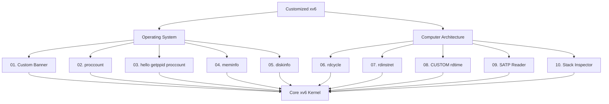

# Customized xv6-riscv Kernel

This project contains 10 modules: 5 Operating System modules and 5 Computer Architecture modules.

## Module Architecture Diagram

## Project Overview

This project extends the MIT xv6-riscv teaching operating system with 10 educational modules. All modules are integrated into final.c on riscv branch.

### Part A: OS Modules

*01. Custom Banner* 
Shows OS name and Aqsa Asif Khan Niazi at boot. Implemented in kernel/main.c.

*02. proccount*
Counts total active processes from process table. Returns count to user space.

*03. hello, getppid, proccount*
Three syscalls in one program. Greeting, parent PID and total processes.

*04. meminfo*
Displays total, free and used physical memory. Reads info from kalloc.c.

*05. diskinfo*
Displays disk size, used and free blocks. Final OS module for storage.

### Part B: Architecture Modules

*06. rdcycle*
Reads RISC-V cycle CSR using assembly. Measures CPU cycles for performance.

*07. rdinstret*
Reads instruction retired CSR. Counts total instructions for CPI analysis.

*08. CUSTOM rdtime*
Custom time CSR reader with unique logic. Different from sstatus, sepc, stvec.

*09. SATP Reader*
Reads SATP register for Sv39 paging. Shows root page table and ASID.

*10. Stack Inspector*
Inspects stack registers sp, fp, ra, gp. Shows trap frame and stack layout.

*Branch: riscv | File: final.c | All 10 Modules Integrated - Verified*
