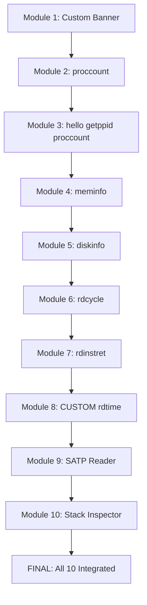

# xv6-my-os - Custom OS by Aqsa Asif Khan Niazi

## OS Module Architecture - 10 Modules Integrated

## Part A: OS Modules

*Module 1: Custom Banner*
Custom kernel banner at boot showing OS name and student info. Implemented in kernel/main.c.

*Module 2: proccount*
Counts total active processes from process table. Returns count to user space.

*Module 3: hello, getppid, proccount*
Three syscalls in one test. hello greets, getppid gives parent PID, proccount counts processes.

*Module 4: meminfo*
Shows total, free and used physical memory. Reads data from kalloc.c.

*Module 5: diskinfo*
Shows disk size, used and free blocks. Final OS module with complete storage info.

## Part B: Architecture Modules

*Module 6: rdcycle*
Reads RISC-V cycle CSR for CPU cycle count. Measures code performance via direct assembly.

*Module 7: rdinstret*
Reads instret CSR for retired instruction count. Used for CPI and performance analysis.

*Module 8: CUSTOM rdtime*
Custom time CSR reader with unique logic. Different from sstatus, sepc, stvec.

*Module 9: SATP Reader*
Reads SATP register for Sv39 paging and root page table. Shows virtual memory layout.

*Module 10: Stack Inspector*
Inspects RISC-V stack registers sp, fp, ra, gp. Shows trap frame and stack layout.
