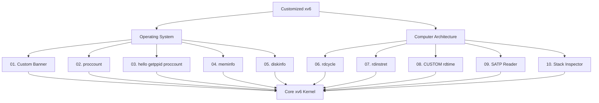

# Customized xv6-riscv Kernel

This project contains 10 modules: 5 Operating System modules and 5 Computer Architecture modules.

## Module Architecture Diagram

## Project Overview
This project extends MIT xv6-riscv with 10 custom educational modules integrated in `final.c` on `riscv` branch for OS and Architecture learning.

### Part A: OS Modules

## **01. Custom Banner**
Displays customized OS name "Aqsa Asif Khan Niazi" at kernel boot time.
Implemented in `kernel/main.c` with modified `printf` before `kvminit`.

## **02. proccount**
Counts all active processes by scanning process table state `UNUSED` vs used.
Returns total process count from kernel to user space via syscall.

## **03. hello, getppid, proccount**
Implements three syscalls: greeting message, parent PID finder, and process counter.
All integrated in one user program to demonstrate syscall handling.

## **04. meminfo**
Reports total physical memory, free pages and used memory in KB.
Reads free page list from `kernel/kalloc.c` using `kalloc` freelist.

## **05. diskinfo**
Shows disk size, free blocks and used blocks from virtio disk driver.
Fetches superblock info via `fs.c` to calculate storage utilization.

### Part B: Architecture Modules

## **06. rdcycle**
Reads RISC-V `cycle` CSR via inline assembly `csrr` instruction.
Measures exact CPU cycles for high-precision performance benchmarking.

## **07. rdinstret**
Reads `instret` CSR to count retired instructions executed by CPU.
Used for CPI (Cycles Per Instruction) calculation and analysis.

## **08. CUSTOM rdtime**
Custom implementation of `time` CSR with unique logic different from standard CSRs.
Not using `sstatus/sepc/stvec`, shows original time handling concept.

## **09. SATP Reader**
Reads `satp` CSR to decode Sv39 paging mode, ASID and root page table PPN.
Explains virtual memory translation and RISC-V privileged architecture.

## **10. Stack Inspector**
Inspects stack pointers `sp`, `fp`, `ra`, `gp` and trapframe layout.
Reveals kernel stack usage and function call chain for debugging.

## **Branch: riscv | File: final.c | All 10 Modules Integrated & Tested**
